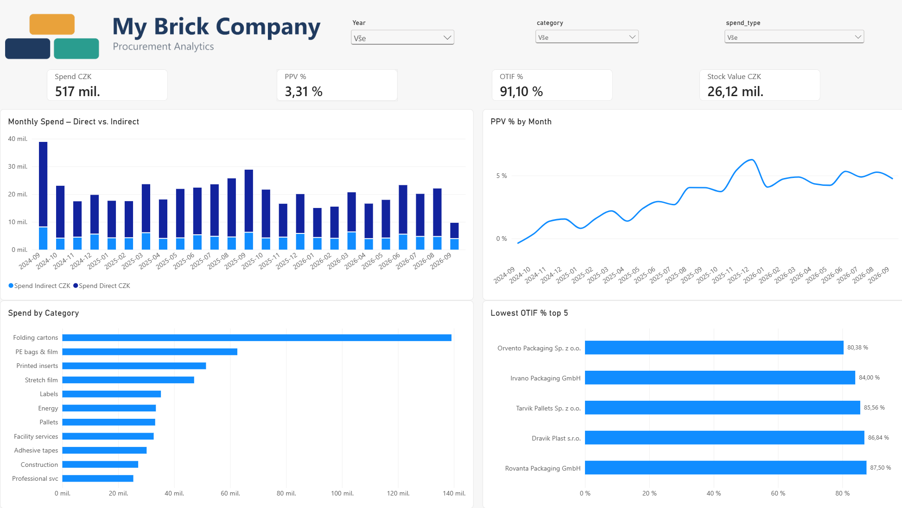
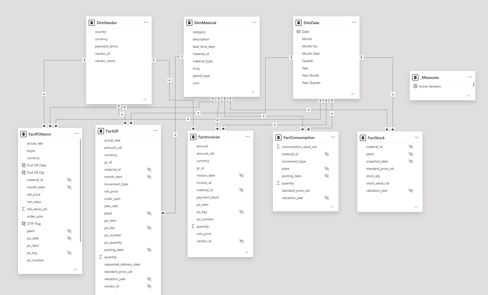
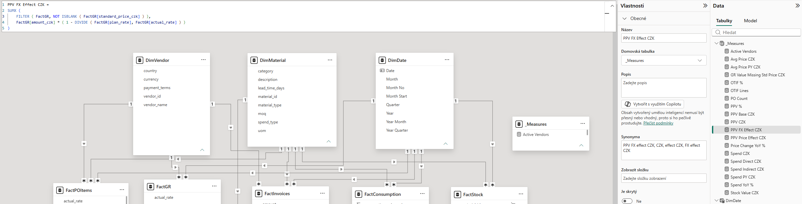
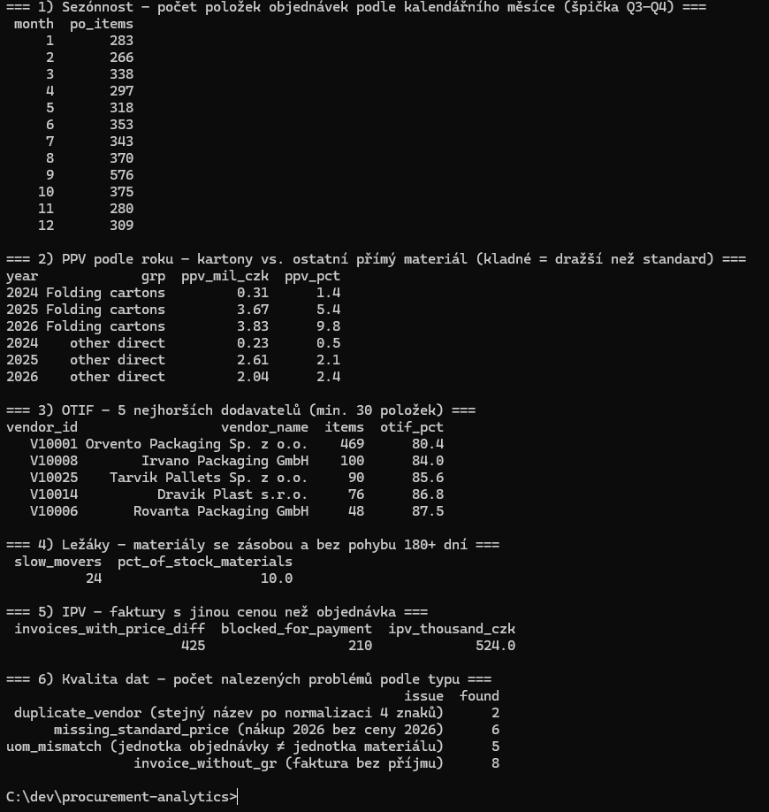

# MBC Procurement Analytics

End-to-end procurement & supply chain analytics for the packaging plant of a **fictional**
manufacturer, My Brick Company (MBC) – from SAP-style source data to a Power BI dashboard.
All data is **synthetic** – no real company data.

The dashboard answers three questions:
1. **Where do we pay more than planned?** – purchase price variance (PPV), split into price and FX effect
2. **Which suppliers don't deliver reliably?** – OTIF (on time in full)
3. **Where is cash tied up in stock?** – inventory value, turnover, slow movers



## Key findings
- **PPV of CZK 12.7 M (3.3 %)** – about 60 % comes from folding cartons, following the corrugated board price index.
- **Unfavourable FX effect of CZK 3.5 M** – the koruna strengthened against the euro, but the zloty appreciated ~11 % and the largest carton supplier is Polish.
- **OTIF 91 %** overall, but only **80 %** for the largest carton supplier – cheap but unreliable.
- **Inventory CZK 26 M**, turnover ~7× per year, **10 % slow movers** (no movement 180+ days).

## Data model
Star schema – 5 fact tables (PO items, goods receipts, invoices, consumption, stock snapshots)
and shared dimensions for material, vendor and date. Source tables are modelled on SAP:
LFA1, MARA, MBEW, EKKO/EKPO, MATDOC (movement types 101/261), RBKP/RSEG, MARD, TCURR.



## DAX highlights
- PPV calculated per goods receipt, split into **price effect** and **FX effect** (actual vs. plan rate)
- Year-over-year price change on a **like-for-like** basis (removes mix effect)
- OTIF flag per PO line (first delivery on time **and** in full)
- **Semi-additive** stock value – closing balance of the period, not a sum over months



## Validation & data quality
Every key figure is validated three ways – Python, SQL and Power BI.
21 data quality issues of 4 types are planted on purpose (duplicate vendor, missing standard
price, unit-of-measure mismatch, invoice without goods receipt) and detected by explicit rules
– see `data/dq_answer_key.csv` and `docs/data_dictionary.md`.



## Repository
| Folder | Content |
|---|---|
| `generator/` | Python generator of the reproducible dataset (fixed seed) + SQL pattern checks |
| `data/` | Generated tables as CSV (Power BI source) and SQLite (`mbc.db`) |
| `powerbi/` | `MBC_Procurement.pbix` – the dashboard (open in Power BI Desktop) |
| `docs/` | Data dictionary – tables, columns, SAP equivalents, known data quality issues |
| `screenshots/`, `assets/` | Images and logo |

## Run
```bash
pip install pandas numpy pyyaml
python generator/generate_data.py
python generator/check_patterns.py
```
To open the dashboard, download `powerbi/MBC_Procurement.pbix`. If the CSV path differs on your
machine, update it in Power Query (*Transform data → Data source settings*).

---
Built with an AI assistant (Claude) as a pair programmer; business logic, KPI definitions,
data model decisions and validation of all numbers are my own.
